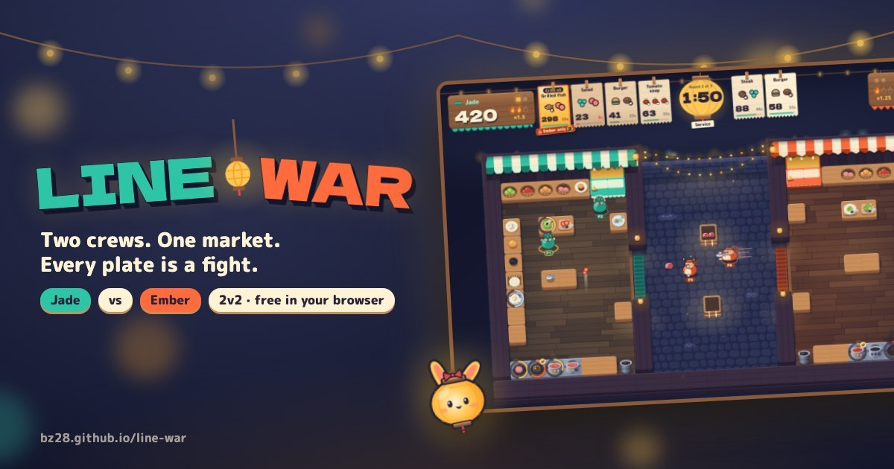

# LINE WAR

**Two crews. One market. Every plate is a fight.**

LINE WAR is a competitive 2v2 cooking game for the browser. Two rival street-food stalls, Jade and Ember, race to
serve orders from one shared ticket line, fighting over the contested market between their kitchens. Play 2v2,
1v1, or with bots filling any seat.

**Play it free: https://bz28.github.io/line-war/**



## How to play

**The loop.** Grab ingredients, prep them (chop, pan, pot), plate them and ring them out at your pass. Every ticket
on the line is shared: the first crew to serve it wins it, and fresher plates pay more. Food you carry through the
market can be knocked loose by a rival's dash, so guard it or take theirs.

- **Heat.** Clean serves in a row build your crew's Heat, up to three flames. Each flame multiplies what your plates
  pay (×1.25, ×1.5, ×2). Burning food costs a flame.
- **Dinner Rush.** The last minute of every round. Tickets come faster and every serve pays ×1.75, so a crew that is
  behind can still close the gap. The final ten seconds are Last Call.
- **The Critic.** Once a round, halfway through, a gold Critic ticket appears worth three times its recipe. The crew
  that is behind sees it a few seconds early.
- **Charms.** Lantern-bunny figurines turn up in the middle of the market. Carry one home for +50 points and a flame
  of Heat. Every charm you bank is added to your charm shelf, and you can hang a favourite from your crew sign.

Matches are best of three rounds by default. Round length, prep time, the number of rounds, Dinner Rush, the Critic
and Brunch Speed (slower timers) are all in Settings.

## Levels

- **Night Market**: steak and fish sit in the open market between the two stalls. Grab them, guard them, knock them loose.
- **Harbor Pier**: fish night. One narrow door per stall, steak between the doors, and fish across the pond.
- **Rooftop Garden**: the produce war. Lettuce and tomatoes only grow in the shared garden, and each stall has two doors to defend.

## Controls

| Action | Player 1 | Player 2 | Gamepad |
| --- | --- | --- | --- |
| Move | W A S D | Arrow keys | Left stick / D-pad |
| Grab / place / serve | Space | Enter | A |
| Chop / wash / put out fire (hold) | E | / | X |
| Dash (knocks rivals in the market) | Left Shift | Right Shift | B |
| Throw | Q | . | Y |
| Pause | Esc | Esc | Start |

Every key can be rebound in Settings, and each of the four seats can be a keyboard, a gamepad, a bot or empty.
How to play in the game shows your current bindings.

## Bots

Any seat can be an easy, normal or hard bot, so you can play solo with a bot partner against two bots, or watch four
bots play. The same bots drive `tools/botsim`, which plays hundreds of headless matches to check the balance.

## Development

Requires Node 22 and pnpm.

```sh
pnpm install   # install the workspace
pnpm dev       # run the client at http://localhost:5173
pnpm check     # typecheck and run every test
pnpm build     # production build of the client
pnpm --filter @line-war/botsim sim -- --matches 200 --scenario all --workers 6   # headless balance report
```

Botsim writes its report to `tools/botsim/reports/latest.md`; pass `--arena harbor-pier` or `--arena rooftop-garden`
for the other levels. Every merge to `main` deploys to GitHub Pages.

## Repo layout

```
packages/sim       deterministic game rules (pure TypeScript, 30 Hz fixed step, no DOM)
packages/content   levels, recipes, ingredients and charms (data only)
packages/bots      scripted bot players
apps/client        browser client: canvas renderer, HUD, menus, input, audio, settings
tools/botsim       headless bot matches and the balance report
tools/design-sim   the pre-build Python design simulator
docs/              rules spec (RULES.md), design (GAME_DESIGN.md), art bible (ART.md), build plan, screenshots
```

Contributor and agent guide: [`CLAUDE.md`](CLAUDE.md).
